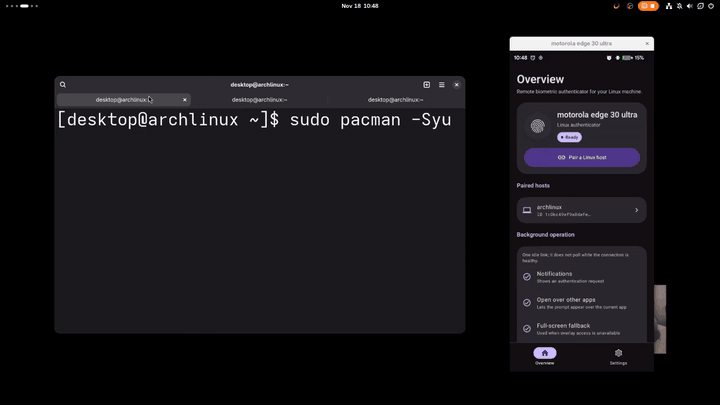

# Android Remote Biometric Authenticator for Linux

An Android phone acts as a **remote cryptographic authenticator** for a Linux
machine. The phone approves with Android's system biometric UI; Linux verifies a
signature over a fresh challenge instead of trusting a transmitted `YES`.

<p align="center">
  <a href="media/demo/demo-v2.mp4">
    
  </a>
</p>

<p align="center">
  <a href="media/demo/demo-v2.mp4">▶ Watch the full demo video</a>
</p>

<p align="center">
  
  &nbsp;&nbsp;
  
</p>

<p align="center"><sub>Fingerprint mark adapted from <a href="https://www.svgrepo.com/svg/246819/fingerprint">SVG Repo's Security 15 collection</a> (CC0), heavily modified.</sub></p>

```text
$ phone-authctl authenticate --user alice --purpose sudo

Waiting for authentication on Pixel 9 for alice…

[phone] Authorize: user=alice host=workstation action=sudo
[phone] Confirm with your fingerprint.

Authenticated.
  device    Pixel 9
  user      alice
  purpose   sudo
```

## Status

| Component | State |
|---|---|
| Protocol specification | complete, normative |
| Rust implementation | complete, 200 tests |
| Kotlin implementation | complete, 124 cross-language conformance checks |
| `phone-authd` | working end to end: pairing, challenge/response, verification, revocation |
| `phone-authctl` | working |
| `phone-auth-sim` | working, including deliberate misbehaviour for tests |
| `pam_phone_auth` | one line in the PAM stack you choose; scope it to `sudo`, polkit or login deliberately (`make verify-all-auth`) |
| Android app | validated on a Motorola Edge 30 Ultra: Wi-Fi discovery, both pairing code directions, background auto-prompt, biometric-gated signing, auto-close after the decision |
| polkit agent | **unnecessary** — see below. Kept for headless hosts only |
| BLE transport | framing and segmentation complete and tested; BlueZ/central wiring not done |
| fprintd compatibility | not started, deliberately last |

Verification commands, and what each proves:

```bash
make test         # Rust: protocol, daemon, security suite, PAM, vectors
make vectors-kt   # Kotlin against the shared vectors, no Gradle needed
make e2e          # real daemon + simulator: pair, authenticate, replay, leak checks
make verify       # everything above (Rust + Kotlin vectors + end to end)

make android-all  # Android lint, unit tests, debug APK (needs ANDROID_HOME)
```

Latest run: 200 Rust tests pass with no clippy warnings; the Kotlin runner agrees
with Rust on 124 checks; the end-to-end smoke test passes; the Android app lints
clean, passes 31 unit tests, builds a debug APK, and has been exercised end to end
on a physical phone in the foreground and in the background.

## Design commitments

* **The proof is a signature over context.** A response covers the host, device,
  request id, user, purpose, service, operation, challenge and expiry, under a
  domain separator. Changing any one of them changes what the user approved.
* **Canonical encoding, enforced.** Payloads are canonical CBOR and the decoder
  rejects every non-canonical form, so exactly one byte string can represent a
  given message. Signing the bytes is therefore unambiguous.
* **Biometric material never moves.** The app asks Keystore to sign and never
  sees a key. A failure to sign is a denial, never an approval.
* **Explicit pairing.** A short-lived session, a six-digit code shown on one
  endpoint and typed on the other (`--code-entry device|host`), reciprocal MACs,
  and a phone-side human gate. No permanent pairing mode, and discovery alone
  authorises nothing.
* **Fail closed.** Every failure mode denies. The PAM *stack* may fall through to a
  password; the module itself never converts a protocol failure into success.
* **Revocation is immediate, then best-effort.** The phone forgets a host locally
  first. If the pinned link is up it sends a host-issued bearer `UNPAIR` token, and
  the host marks that record revoked. If the host is offline the token is carried
  in the next pairing submit and the host cleans the old record before committing
  the new one. The token authorises revocation only; it is not authentication, and
  losing it means the host operator revokes manually.
* **Transport is not identity.** Wi-Fi and BLE carry identical frames. Which link
  is used changes at most the freshness window.

Known limitations are listed in [`docs/threat-model.md`](docs/threat-model.md),
including the one that matters most: the pairing code is a six-digit short
authentication string over an ephemeral ECDH transcript, not a PAKE. A key
substitution changes the derived code on each endpoint, but an active attacker
still has about a `2^20` window per live, single-use pairing session. Both
ephemeral private keys are discarded, so a recorded transcript does not reveal
the pairing secret to a later key compromise.

## Repository layout

```text
protocol/
  specification/PROTOCOL.md   normative spec: framing, messages, transcript, pairing
  test-vectors/               shared fixtures both implementations must satisfy

linux/
  protocol/                   Rust: CBOR, framing, crypto, verification, replay guard
  phone-authd/                the daemon: pairing, engine, registry, transports, IPC
  phone-authctl/              operator CLI
  phone-auth-sim/             fake device, can misbehave on demand
  pam-phone-auth/             thin PAM adapter
  systemd/                    service and socket units

android/
  protocol/                   Kotlin protocol implementation + vector runner
  app/                        Compose UI, BiometricPrompt, Keystore, transports

docs/
  architecture.md
  threat-model.md
  pairing.md

packaging/                    native packaging skeletons per distribution family
tests/
  e2e-smoke.sh                real end-to-end smoke test
```

## Quick start

```bash
# Linux daemon against a private state directory, no root needed
linux/target/debug/phone-authd \
    --state-dir /tmp/alp/state \
    --socket   /tmp/alp/control.sock \
    --audit-log /tmp/alp/audit.log \
    --port 47123 --bind 127.0.0.1:47123 --no-mdns &

# Pair a simulator
linux/target/debug/phone-authctl --socket /tmp/alp/control.sock pair
# in another terminal, when the code is displayed:
linux/target/debug/phone-auth-sim pair --host 127.0.0.1:47123 --name "Pixel 9" \
    --daemon linux/target/debug/phone-authd \
    --daemon-arg --state-dir --daemon-arg /tmp/alp/state

# Authenticate
linux/target/debug/phone-auth-sim serve --host 127.0.0.1:47123 \
    --ca /tmp/alp/state/host.crt --timeout 120 &
linux/target/debug/phone-authctl --socket /tmp/alp/control.sock \
    authenticate --user "$(id -un)" --purpose sudo
```

`tests/e2e-smoke.sh` does all of this and asserts the security properties.

## Testing the Android app over Wi-Fi

Requirements: a **strong biometric** (fingerprint or strong face) is enrolled on
the phone, the phone and Linux machine are on the same LAN with multicast
enabled, and the phone has been allowed to show notifications. For the app to
open itself over another app, allow **display over other apps** (or the
full-screen-intent fallback) from the app's *Background operation* card. The
service keeps one idle link open; it does not poll while that link is healthy.

```bash
# 1. Build the debug APK
make android-all
adb install -r android/app/build/outputs/apk/debug/app-debug.apk

# 2. Start the daemon so it advertises on the LAN (keep this terminal open)
mkdir -p /tmp/alp
linux/target/debug/phone-authd \
    --state-dir /tmp/alp/state \
    --socket   /tmp/alp/control.sock \
    --audit-log /tmp/alp/audit.log \
    --port 47123

# 3. Start pairing in another terminal.
#    Default (`--code-entry device`): the terminal displays the code; type it on
#    the phone. Add `--code-entry host` to have the phone display it and type it
#    in the terminal instead.
linux/target/debug/phone-authctl --socket /tmp/alp/control.sock pair

# 4. Complete the code gate. `--yes` skips only the host-side prompt; it never
#    skips the typed code.

# 5. Background the app, then request authentication
linux/target/debug/phone-authctl --socket /tmp/alp/control.sock \
    authenticate --user "$(id -un)" --purpose sudo
```

What the phone does:

* **Pairing, default (`--code-entry device`):** names the host and asks you to
  type the six-digit code shown in the Linux terminal. It never displays the code.
  A wrong code is rejected; **Cancel**, back, or a lost connection discards the
  pending host. Only the correct code writes the certificate pin and key.
* **Pairing with `--code-entry host`:** displays the code for you to type in the
  Linux terminal, then still requires an explicit **Allow** on the phone.
* **Authentication:** an auto-opened request uses a transparent host activity, so
  only the system `BIOMETRIC_STRONG` prompt appears over the current app. The
  prompt shows the signed host/user/action context. There is no approve button and
  no authenticator result screen. Closing the prompt, pressing back, or leaving is
  a denial and sends `USER_CANCELLED`.
* **After the decision:** an auto-opened authentication finishes immediately and
  reveals the app that was underneath. Pairing returns to the Overview page.
  Terminal results auto-dismiss; there is no Done/OK button. The foreground
  service stays alive in the background, holding one idle connection.

The APK is debug-signed and installs as `com.androidfprint.debug`; do not treat it
as a production build. The daemon needs inbound UDP 5353 (mDNS) and TCP 47123
(the data connection), so a firewall or guest-Wi-Fi client isolation will stop
discovery. One live host connection is maintained at a time; pair one host per
test.

The *Background operation* card also reports whether notifications, overlay
permission, the full-screen fallback and battery-optimisation exemption are set.
None of those changes the security decision; they only affect whether the prompt
can reach the screen without the app being opened by hand.

The host label shown on the phone is the machine hostname (`archlinux` here). The
systemd unit passes `--host-name %H`, because the service sandbox replaces
`/proc/sys/kernel/hostname` with `linux-host`. The label is display-only and is
never a trust input.

`/tmp/alp` is disposable. For a persistent test installation, keep the state
directory and control socket somewhere under your home directory instead, and
pass the same paths to `phone-authctl`.

## Installing PAM integration

PAM configuration is distro-specific. Install one line in the stack you actually
want the phone to satisfy; there is no portable "one file" that is correct
everywhere.

| Distro | Typical file | Scope |
|---|---|---|
| Arch | `/etc/pam.d/sudo` | `sudo` only. polkit uses `system-auth`; GDM uses `gdm-password`. |
| Debian/Ubuntu | `/etc/pam.d/common-auth` | Included by many services; broad scope. |
| Fedora | `/etc/pam.d/system-auth` / `password-auth` | Broad scope. |

The Arch example is the recommended starting point because it does not silently
change polkit or the login screen:

```bash
sudo cp /etc/pam.d/sudo /etc/pam.d/sudo.bak
sudoedit /etc/pam.d/sudo
```

```text
auth  sufficient  pam_phone_auth.so  purpose=sudo
```

Put it before the `pam_unix.so`/`system-auth` line that would otherwise ask for a
password.

### `sufficient` means password **or** phone

`sufficient` is not MFA. A successful phone check satisfies the stack; if the
phone is absent, unavailable or declines, `pam_unix` still runs and the password
works. That is deliberate availability, but it also means the phone is not a
second factor at that prompt.

If you want password **and** phone, use `required` for both (or a required
substack) and keep a root TTY open while testing. A lost phone then needs that
recovery path rather than a normal login. Do not add `debug` to an installed
line: it is a troubleshooting flag and can write operational detail to syslog.

### Scope and prompt fatigue

A `common-auth`/`system-auth` line applies to `sudo`, `su`, `login`, `sshd`,
`gdm-password`, polkit through the `other` fallback, and more. That is convenient
and is also a prompt-fatigue surface: anything that can trigger PAM can ask the
phone. Start with `sudo`, then add polkit and GDM deliberately.

On Arch, polkit uses `system-auth`; GDM has its own `gdm-password` and
`gdm-fingerprint` stacks. Adding the phone to `system-auth` changes polkit and
other services, not just `sudo`. Keep a root TTY open and make one change at a
time.

Arguments are whitespace-separated `key=value` pairs: `purpose`, `service`,
`device`, and `timeout_ms`. Because libpam splits a configuration line on
whitespace, a value cannot contain a space — write `device=Pixel-9`, not
`device=Pixel 9`.

### Check it and roll it back

```bash
sudo -k && sudo -k    # forget the cached timestamp, twice
sudo -v               # should prompt on the phone, with a deliberately wrong password typed
```

For the sudo-only procedure above, rollback restores the file created by that
same procedure:

```bash
sudo cp /etc/pam.d/sudo.bak /etc/pam.d/sudo
```

If you edited `common-auth` or `system-auth`, restore that file's own backup
instead. Do not copy a `sudo.bak` over a different stack.

`tests/common-auth-integration.sh` exercises the Debian layout; `tests/pam-integration.sh`
loads the real module into a dedicated PAM service. Neither is a substitute for a
root shell and a tested rollback on your machine.

## Why there is no polkit agent

An earlier version of this had one, and it does not work on a normal desktop. polkit
allows **one authentication agent per subject**, and the desktop's own agent
(gnome-shell, polkit-gnome, KAuth) already holds the registration for the session.
Registering there returns:

```
An authentication agent already exists for the given subject
```

and polkit does not offer challenges to an agent on an inactive session, so it never
works anywhere else either. An agent cannot be injected into the desktop to replace
this, and interposing on the bus or substituting polkitd would compromise the entire
authorization stack.

None of that matters, because **polkitd validates a typed password through PAM** — it
opens a PAM transaction named `polkit-1`. There is no `/etc/pam.d/polkit-1`, so libpam
falls back to `/etc/pam.d/other`, which includes `common-auth`. The polkit dialog
already authenticates through PAM.

So the agent is dropped rather than patched. `linux/polkit-agent` remains only as a
possible answer for a headless host with no desktop agent, and it is not part of the
install path.

## Relationship to prior art

`alp` and `pam-android-fingerprint` both solve Android-to-Linux authentication. The
reuse is conceptual: phone as authenticator, PAM integration, Wi-Fi operation.

The departure is the trust model. `alp` is built around a pre-shared key, so
compromise of that one value compromises every host it guards. This implementation
uses per-device asymmetric identity with explicit pairing, so a leaked key affects
one device and is revocable independently.

## Documentation

* [`protocol/specification/PROTOCOL.md`](protocol/specification/PROTOCOL.md) — the
  normative protocol
* [`docs/architecture.md`](docs/architecture.md) — layering and component map
* [`docs/threat-model.md`](docs/threat-model.md) — adversaries, defences, limitations
* [`docs/pairing.md`](docs/pairing.md) — the pairing flow and its guarantees
* [`docs/security-audit.md`](docs/security-audit.md) — audit tracker and current findings
* [`docs/roadmap.md`](docs/roadmap.md) — support matrix, capability protocol and platform roadmap

## Credits

The fingerprint mark is a heavily modified derivative of the
["Fingerprint" icon from the Security 15 collection](https://www.svgrepo.com/svg/246819/fingerprint)
on SVG Repo. The collection is published under the
[CC0 license](https://www.svgrepo.com/page/licensing/#CC0) and uploaded by SVG
Repo; no individual artist is listed. The icons in `media/icons/` and the Android
launcher assets are derivative works of that mark.

## License

0BSD. Do whatever you want with it; there is no warranty.
